# Document Intelligence Platform

A Django-based web application for analyzing legal documents with AI-powered search and Q&A capabilities.

## Features

- 📄 **Document Upload**: Support for PDF, DOCX, and TXT files
- 🔍 **Dual Search**: Keyword search and semantic search with embeddings
- 🤖 **AI Q&A**: Evidence-based question answering with citations
- 📊 **Text Processing**: Automatic chunking, section extraction, and OCR
- 🗂️ **User Isolation**: Each user has their own private document space
- ⏰ **Data Retention**: Automatic cleanup after 60 days

## Screenshots

### 1. User Signup
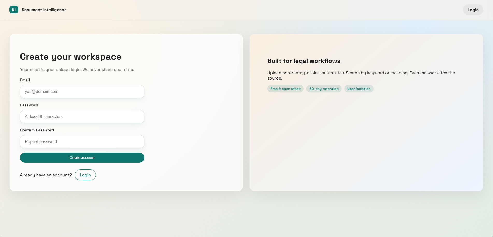

### 2. User Login
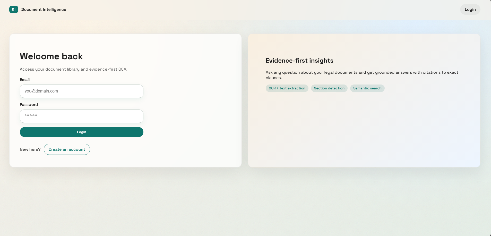

### 3. Home Dashboard
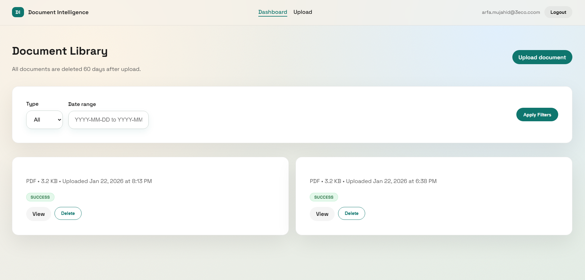

### 4. Document Upload
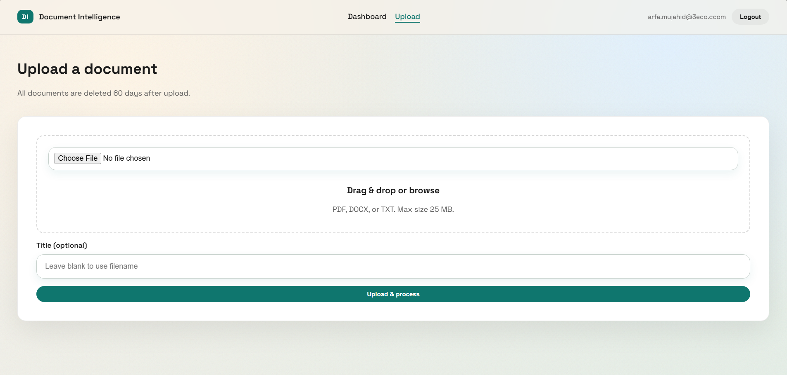

### 5. Upload Error Handling
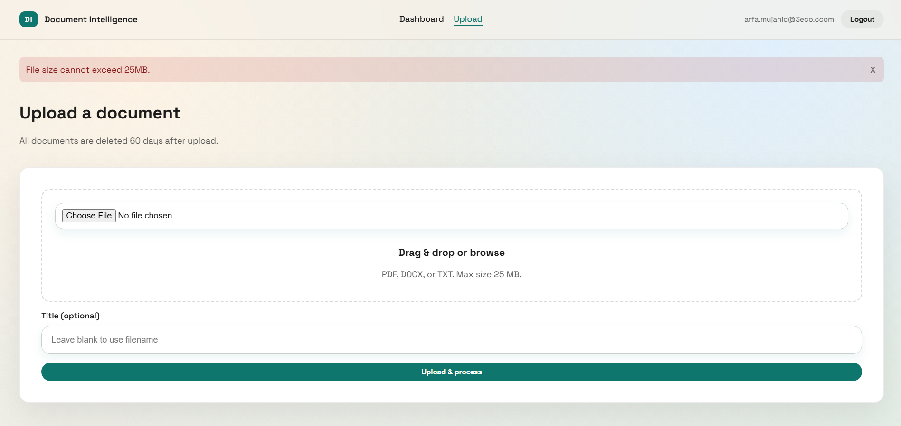

### 6. File Uploaded Successfully
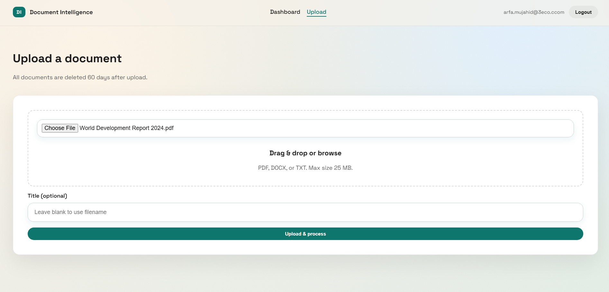

### 7. Document Processing
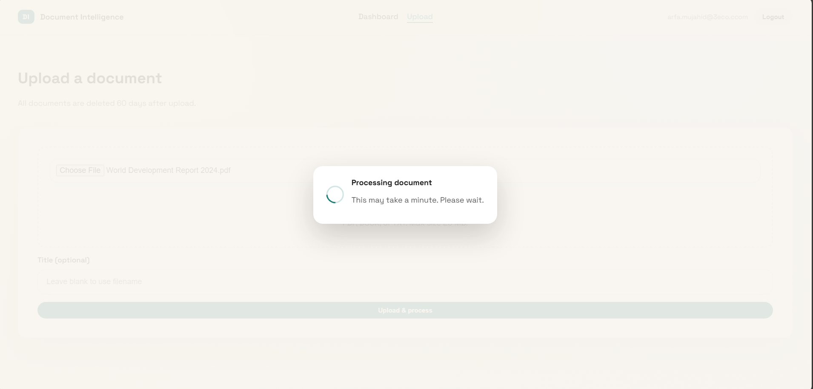

### 8. Processing Complete
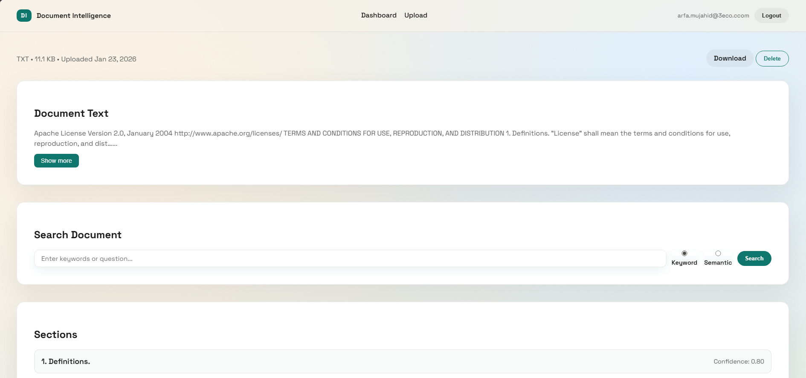

### 9. Uploaded Text View
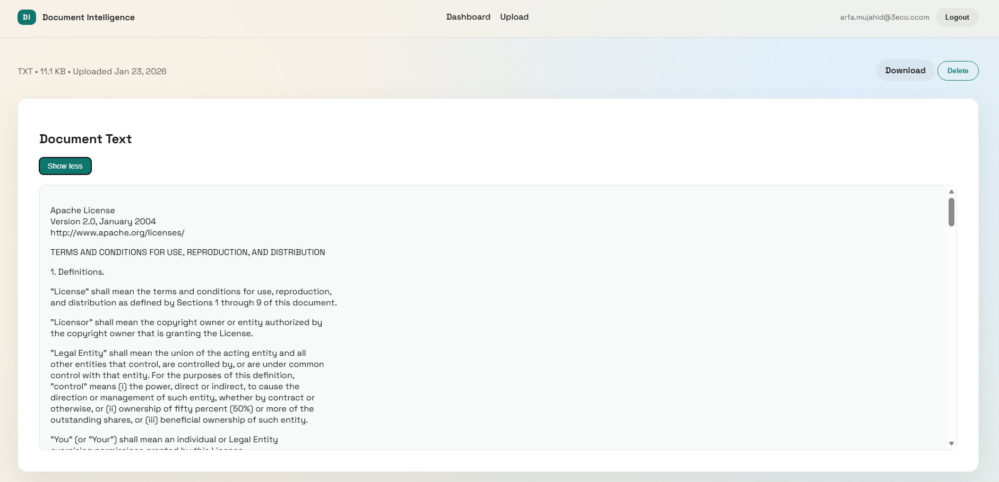

### 10. Keyword Search
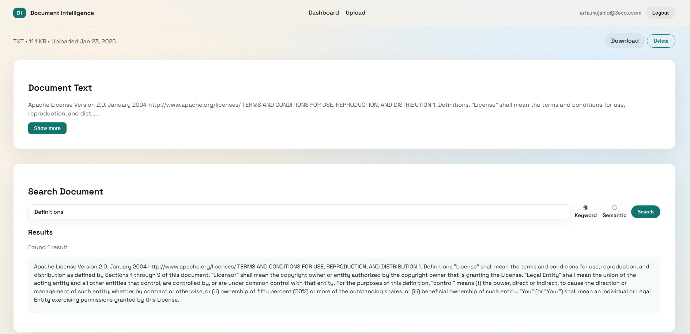

### 11. Semantic Search - Step 1
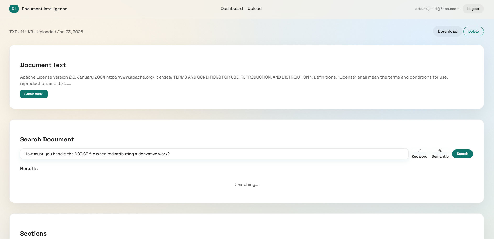

### 12. Semantic Search - Step 2
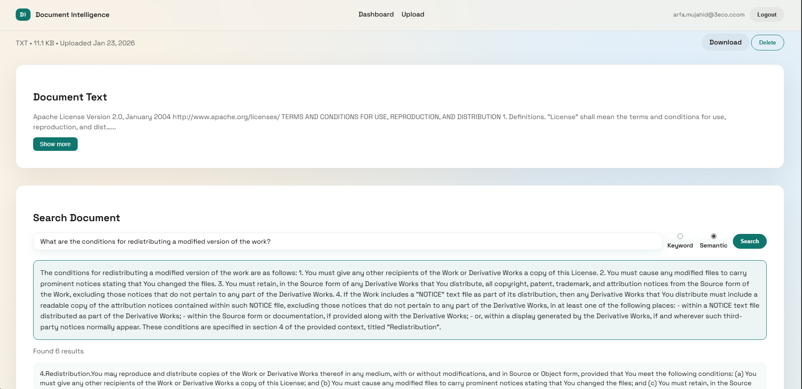

### 13. Semantic Search - Step 3
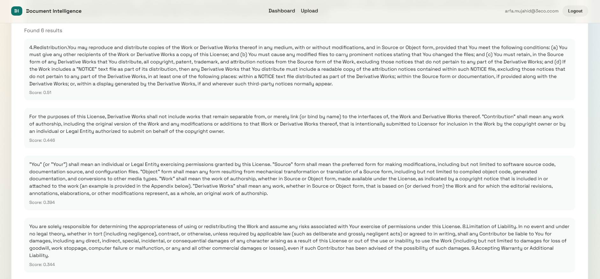

### 14. Semantic Search - Step 4
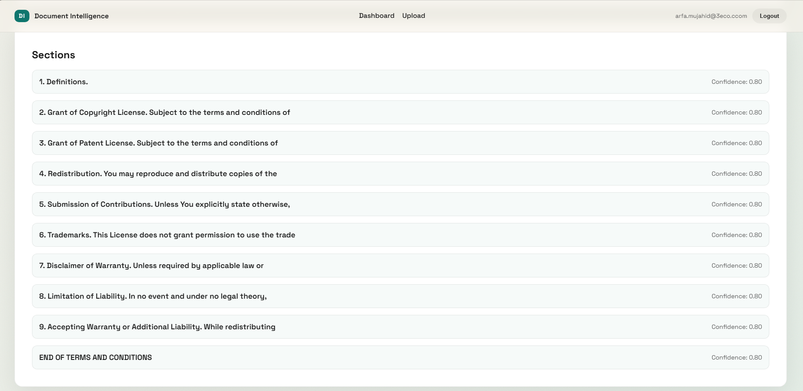

### 15. Deletion Confirmation


---

## Technical Details

### Tech Stack

- **Backend**: Django 6.0.1 (Python 3.12+)
- **Database**: SQLite
- **Vector DB**: Qdrant (embedded on-disk by default; Qdrant server/Cloud optional)
- **Embeddings**: `sentence-transformers/all-MiniLM-L6-v2`, run locally (384-dim)
- **LLM answers**: any OpenRouter model (optional)
- **Frontend**: Django Templates with minimal JavaScript

### Quick Start

#### 1. Setup Virtual Environment

```bash
python3 -m venv .venv
source .venv/bin/activate      # Windows: .venv\Scripts\activate
```

#### 2. Install Dependencies

```bash
pip install -r requirements.txt
```

The first document you process downloads the embedding model (~90 MB) from Hugging Face.

#### 3. Configure Environment

```bash
cp .env.example .env
```

Then edit `.env`:

- `DJANGO_SECRET_KEY`: any long random string.
- `OPENROUTER_API_KEY` and `OPENROUTER_LLM_MODEL` (optional): enable the AI answer on semantic search. Without them, keyword and semantic search still work.
- `OPENROUTER_FALLBACK_MODELS` (optional): comma-separated models tried in order when the main one fails. Free models are often rate-limited (HTTP 429).
- `QDRANT_URL` (optional): leave empty to store vectors in `./qdrant_data` with no server. To use a server, run `docker run -p 6333:6333 qdrant/qdrant` and set `QDRANT_URL=http://localhost:6333`, or point it at Qdrant Cloud with `QDRANT_API_KEY`.
- OCR for scanned PDFs needs the Tesseract binary (`brew install tesseract`). Digital PDFs, DOCX and TXT don't.

#### 4. Run Database Migrations

```bash
python manage.py migrate
```

#### 5. Create Superuser (Optional)

```bash
python manage.py createsuperuser
```

#### 6. Start the Development Server

```bash
python manage.py runserver
```

Visit `http://localhost:8000` in your browser.

### Management Commands

#### Cleanup Expired Documents

Run this command to clean up documents older than 60 days:

```bash
python manage.py cleanup_expired
```

You can schedule this to run daily using cron or Windows Task Scheduler.

### API Endpoints

#### Authentication
- `POST /accounts/signup` - Create new account
- `POST /accounts/login` - Login
- `POST /accounts/logout` - Logout

#### Documents
- `GET /documents` - List user's documents
- `POST /documents/upload` - Upload new document
- `GET /documents/{id}` - View document
- `GET /documents/{id}/download` - Download document
- `POST /documents/{id}/delete` - Delete document

#### Search
- `POST /search/keyword` - Keyword search
- `POST /search/semantic` - Semantic search
- `GET /search/history` - Search history

#### Q&A
- `POST /qa/ask` - Ask a question
- `GET /qa/history` - Q&A history

### File Structure

```
legal_document_analyzer/
├── accounts/          # User authentication
├── core/              # Shared utilities
├── documents/         # Document management
├── logs/              # Error logging
├── processing/        # Text processing pipeline
│   ├── services.py    # Text extraction, chunking
│   ├── vector_service.py  # Vector embeddings
│   └── tasks.py        # Processing pipeline
├── qa/                # Q&A system
├── search/            # Search functionality
├── templates/         # HTML templates
├── legal_document_intelligence/  # Django project
└── media/             # File uploads
```

### Development Notes

#### Adding New Document Types

1. Update `DocumentUploadForm` in `documents/forms.py`
2. Add extraction logic to `TextExtractor` in `processing/services.py`
3. Update file type validation

#### Customizing Chunking

Modify `TextChunker` class in `processing/services.py`:
- `chunk_size`: Default 1000 characters
- `overlap`: Default 200 characters

#### Changing AI Models

Update `.env` file:
- `OPENROUTER_LLM_MODEL`: For AI answers
- `OPENROUTER_FALLBACK_MODELS`: Backup models for AI answers, tried in order
- Embeddings run locally: change `EMBEDDING_MODEL_NAME` in `processing/vector_service.py` (and the vector size) to use another sentence-transformers model

### Troubleshooting

#### Common Issues

1. **"No such host is known"** - Check your database URL in `.env`
2. **"Vector collection not found"** - Run the app once to auto-create collections
3. **"OCR failed"** - Install Tesseract on your system for PDF OCR

## Support

For issues and questions, check the error logs or create an issue in the project repository.
